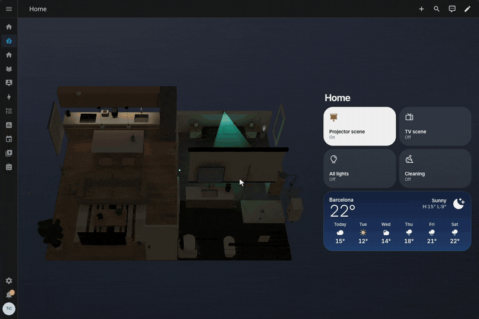

# Diorama

A Home Assistant card that turns your home into a small 3D model you can click.

Draw your rooms, furnish them from a catalog of sofas, lamps, doors, blinds, appliances and sensors, then bind the pieces to your real Home Assistant devices. The model shows what your home is doing right now: a lamp glows when the light is on, a blind sits where the cover is, a door swings open when the sensor says so. Click a piece and the device behind it toggles.

A sharper version of the clip is in [docs/video/demo.mp4](docs/video/demo.mp4).

## What you get

- **Your own layout.** Trace each room on a grid in the visual editor. Walls, floor materials and openings follow.
- **A furnished home, not a floor plan.** Around a hundred pieces in several styles each: sofas, beds, kitchens, plants, rugs, mirrors, radiators, TVs, speakers, vacuum robots and more, each with its own size and color options.
- **Pieces that are devices.** Most pieces can stand for a Home Assistant entity. Lights, switches, covers, media players, fans, locks, climate, vacuums and binary sensors are all understood. The piece shows the entity's state, and a click calls the matching service: toggle, open or close, lock or unlock, start or dock. A long press opens the device's own dialog.
- **Camera views.** Save the view the card opens with and one per room. Clicking a room's floor flies there and fades the rest of the home away, and arrows on the floor lead to the rooms next door. Click the floor again, click any empty space on the dashboard, or press back to come home.
- **Light that matters.** Lights cast real light and shadows in their room, with brightness and color temperature taken from the entity, and the sun moves across the home through the day.

| Lights off                                                                | Lights on                                                                 |
| ------------------------------------------------------------------------- | ------------------------------------------------------------------------- |
|  |  |

## Tiles and the side panel

Diorama brings its own tiles and cards in the same look as the model: toggles for lights and switches, sliders for brightness and blinds, a dial for a thermostat, media controls with the cover art, a camera, the weather, a calendar, a to-do list and more. They come in the same download, and every one can be set up from Home Assistant's own card editor.

The easiest way to use them is the side panel. Turn on **Show the side panel** in the card's settings and the model moves to the left, with its tiles on the right. You do not lay them out yourself: the panel builds them from your plan, with a heading for each room and a tile for each device you placed in it.

The panel follows the camera. With the whole home in view it shows every room. Click a room and, as the camera flies there, the tiles fade to that room's alone. Come back and they all return. On a phone the tiles sit under the model.

In the card's settings you can shape what the panel shows:

- **Add what has no piece.** A scene, a sensor or a thermostat can join a room's tiles, even with nothing on the plan for it.
- **Put them in order.** Drag each row by its handle, and the tiles follow.
- **Pick another look.** Tap the card name under any entity to see every card it can be, live, and pick one: a lamp as a big dial instead of a toggle, a camera made taller, a blind with its buttons.
- **A home section.** Tiles that are for the whole home, like the weather or an all lights off switch, go under **Home**. They show while the whole home is in view, and each room's own tiles show once you fly to it.

If you would rather place the tiles yourself, leave the panel off and put them next to the card. Turn on **Hide other rooms' tiles** and they still follow the room in view.

## The editor

Everything is built inside Home Assistant, in the card's own full-screen editor. The plan sits on top, a live 3D preview below and the catalog on the right. Draw rooms, drop pieces in, drag them, snap them to walls, tweak their style and colors, and pick the entity each one stands for.

## Install

1. In Home Assistant open **HACS**, open the three-dot menu in the top right and choose **Custom repositories**.
2. Paste `https://github.com/CarlesRojas/ha-diorama`, pick the **Dashboard** type and add it.
3. Search for **Diorama** in HACS and download it. HACS registers the card's resource for you.
4. Reload the browser.
5. Edit a dashboard, choose **Add card** and search for **Diorama**.

Updates arrive through HACS like any other card. If a new version does not show up after updating, clear the browser cache. The card logs its version in the browser console on load, so a stale copy is easy to spot.

Install by hand, without HACS

1. Download `card.js` from the [latest release](https://github.com/CarlesRojas/ha-diorama/releases/latest) into `config/www/diorama/card.js`.
2. In **Settings > Dashboards**, open the three-dot menu, choose **Resources** and add `/local/diorama/card.js` as a **JavaScript module**.
3. Edit a dashboard, choose **Add card** and search for **Diorama**.

When you update, bump a `?v=` query on the resource URL so browsers pick up the new file.

## Start building

1. Add the card to a dashboard and press **Open editor**.
2. Trace your first room on the grid.
3. Open the catalog and drop in a ceiling light and a sofa.
4. Select the light and pick the Home Assistant entity it stands for.
5. Save, then click the light in the card. It lights up, and so does the real one.

For a furnished starting point, paste [demoflat.yaml](demoflat.yaml) into a card's YAML editor. It is the flat in the screenshots above, with entity ids you can swap for your own.

Changes are listed in the [changelog](CHANGELOG.md).
