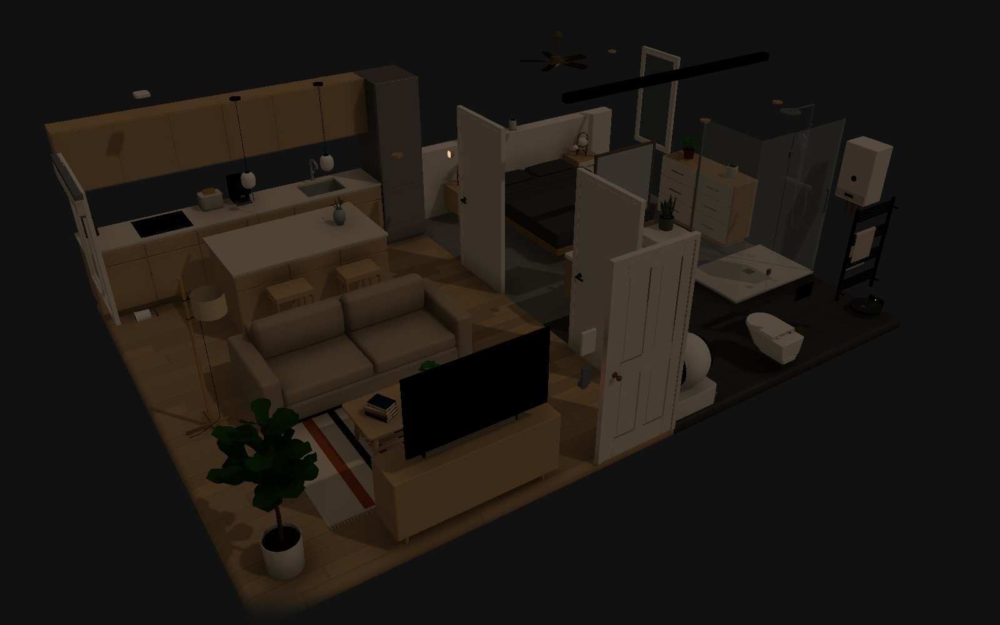
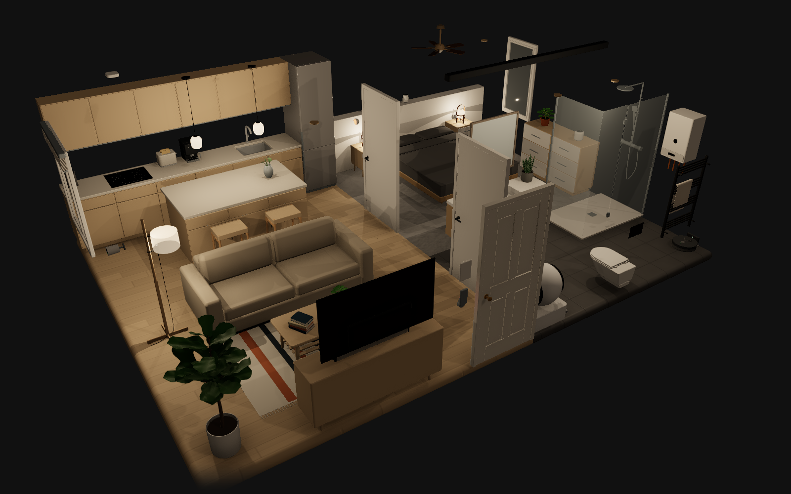
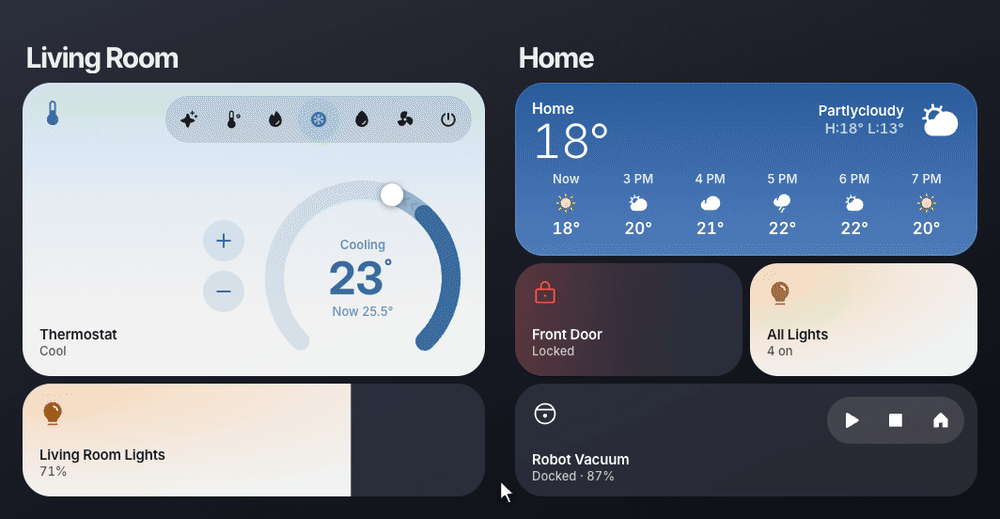
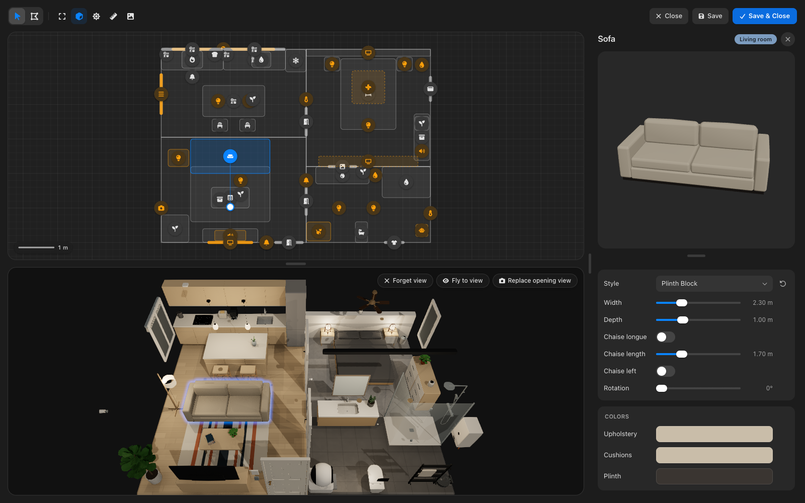

# Diorama

A Home Assistant card that turns your home into a small 3D model you can click.

Draw your rooms, furnish them and bind the pieces to your Home Assistant devices. The model shows what your home is doing right now: a lamp glows when its light is on, and a click on it turns it off. Widgets for every device come along, built for you from the plan.

A sharper version of the clip is in [docs/video/demo.mp4](docs/video/demo.mp4).

## What you get

- **Your own layout.** Trace each room on a grid. Walls, floors and openings follow.
- **A furnished home.** Around a hundred pieces, from sofas and beds to TVs and plants, each in several styles and colors.
- **Pieces that are devices.** Lights, covers, locks, fans, media players and more show their state, and a click controls them.
- **Camera views.** Click a room to fly there, and come back with another click.
- **Real light.** Lamps light their room and cast shadows, and the sun moves through the day.
- **Widgets.** A side panel with a widget for each device, following the room in view.

| Lights off                                                                | Lights on                                                                 |
| ------------------------------------------------------------------------- | ------------------------------------------------------------------------- |
|  |  |

## Widgets

Diorama comes with its own widgets in the same look as the model. Turn on **Show the side panel** and they appear next to it, one for each device you placed, grouped by room. You can also use them on their own, anywhere on a dashboard.

## The editor

Everything is built inside Home Assistant, in the card's own full-screen editor. The plan sits on top, a live 3D preview below and the catalog on the right. Draw rooms, drop pieces in, drag them, snap them to walls, tweak their style and colors, and pick the entity each one stands for.

## Install

1. In Home Assistant open **HACS**, open the three-dot menu in the top right and choose **Custom repositories**.
2. Paste `https://github.com/CarlesRojas/ha-diorama`, pick the **Dashboard** type and add it.
3. Search for **Diorama** in HACS and download it. HACS registers the card's resource for you.
4. Reload the browser.
5. Edit a dashboard, choose **Add card** and search for **Diorama**.

Updates arrive through HACS like any other card. If a new version does not show up after updating, clear the browser cache. The card logs its version in the browser console on load, so a stale copy is easy to spot.

Install by hand, without HACS

1. Download `card.js` from the [latest release](https://github.com/CarlesRojas/ha-diorama/releases/latest) into `config/www/diorama/card.js`.
2. In **Settings > Dashboards**, open the three-dot menu, choose **Resources** and add `/local/diorama/card.js` as a **JavaScript module**.
3. Edit a dashboard, choose **Add card** and search for **Diorama**.

When you update, bump a `?v=` query on the resource URL so browsers pick up the new file.

## Start building

1. Add the card to a dashboard and press **Open editor**.
2. Trace your first room on the grid.
3. Open the catalog and drop in a ceiling light and a sofa.
4. Select the light and pick the Home Assistant entity it stands for.
5. Save, then click the light in the card. It lights up, and so does the real one.

For a five minute walkthrough that builds a small home from an empty card, watch the [tutorial](docs/tutorial/tutorial.mp4).

For a furnished starting point, paste [demoflat.yaml](demoflat.yaml) into a card's YAML editor. It is the flat in the screenshots above, with entity ids you can swap for your own.

Changes are listed in the [changelog](CHANGELOG.md).
